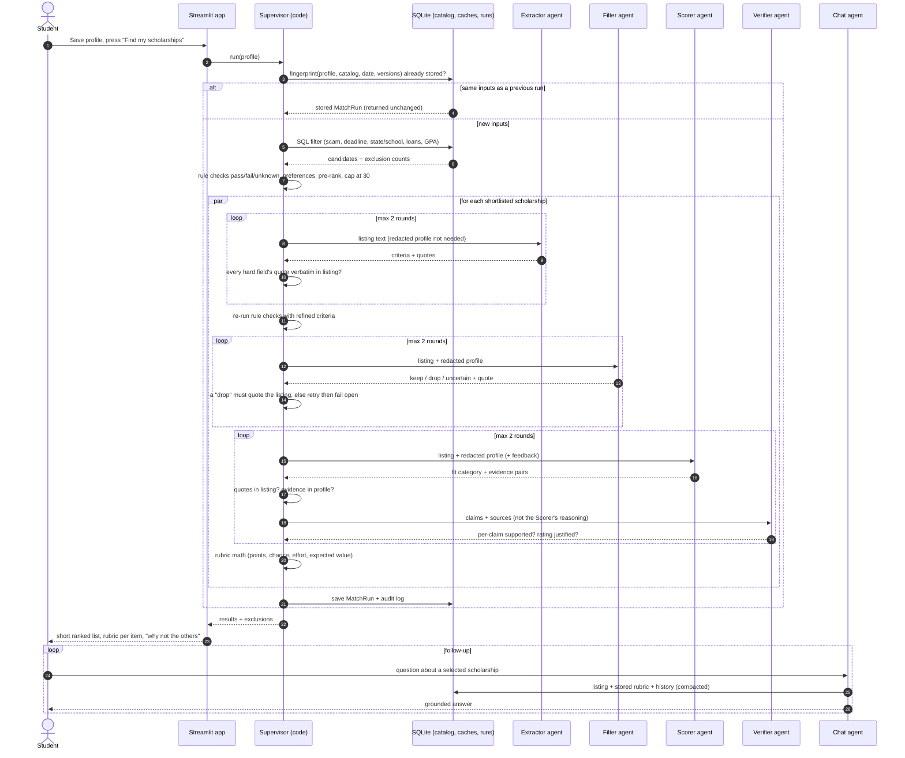

# ScholarMatch — Architecture (as built)

Refines the "Basic Architecture" and "Solution Mitigation" sections of the original `.qmd`. The shape is
the same — deterministic filter → fuzzy filter → scorer, with a supervisor checking each hand-off, then a
table and a chat — with the changes called out in the last section.

## Pieces

```
scrapers/ ──► ingest (scam screen + rule extraction) ──► SQLite catalog
                                                             │
Streamlit app ── profile ──► Supervisor ─────────────────────┤
     ▲                          │  1 SQL filter              │
     │                          │  2 rule checks (pass/fail/unknown)
     │                          │  3 preference filter, pre-rank, cap at 30
     │                          │  4 per scholarship, in parallel:
     │                          │       Extractor ─► re-check rules ─► Filter ─► Scorer ⇄ Verifier
     │                          │  5 rubric math (code) ─► MatchRun (stored, fingerprinted)
     └── ranked list, rubric, exclusions, saved, chat (ChatAgent, grounded on the stored run)
```

| Component | Kind | Job | Output contract |
|---|---|---|---|
| Supervisor | code | Owns control flow; gates every agent; retries with feedback; fails safe; writes the audit log | `MatchRun` |
| Extractor | LLM | Listing text → structured eligibility with a verbatim quote per field | `ExtractedCriteria` |
| Filter | LLM | Catch free-text requirements the rules missed (memberships, employers, programs) | `FilterVerdict` keep / drop / uncertain |
| Scorer | LLM | Judge fit as strong / moderate / weak / none with evidence pairs; essay reuse | `ScoreJudgement` |
| Verifier | LLM | Independently check each of the Scorer's claims against the sources | `Verification` |
| Chat | LLM + 2 read-only tools | Answer follow-ups about one scholarship | text |
| Rubric | code | Turn judgements into points, estimated chance, effort, expected value | `MatchResult` |

## Sequence



## LLM / RAG issues → mitigations

| Issue (original #) | Pattern used | How it is enforced |
|---|---|---|
| 1. Student PII reaches the LLM | Data minimisation + provider choice | `redacted_view()` omits name, contact, sub-state location and demographics; those are matched locally. Essays → PII-stripped themes. Provider is swappable (`anthropic`, or any OpenAI-compatible endpoint such as an institution-hosted gateway) behind one interface. Verified by `test_no_pii_reaches_agents`. |
| 2. Hallucinated match / non-match | Deterministic-first + grounding gate + fail-open | Structured rules decide eligibility in code. An agent can only remove a scholarship with a verbatim quote of the requirement; otherwise the verdict becomes "uncertain" and the item stays, flagged. |
| 3. Missed or invented criteria; context rot on long listings | Reflexion (one feedback retry) + rule cross-check + isolation | One listing per call. Each extracted hard field needs a verbatim quote or it is sent back, then discarded in favour of the rule-based value. Rule/LLM disagreements on GPA are noted. |
| 4. Non-deterministic scoring and probabilities | Categorical judgement + code-side rubric; chain-of-verification; response cache | Agents never emit numbers. The Verifier re-checks each claim independently; disagreement → feedback → retry → conservative rating. Identical inputs hit the cache, identical requests return the stored run. |
| 5. Chat context rot / forgetting its reasoning | Re-grounding every turn + persisted history + compaction + tools | The listing and the stored rubric are re-injected each turn (the agent never relies on its own earlier text); turns are saved; older turns are summarised past 8; two read-only tools fetch other matches for comparisons. |
| new: prompt injection via scraped text | Untrusted-data framing + no write tools | Listings are wrapped in tags and declared data-only; no agent has a tool that changes state. |
| new: cost blow-up on a large catalog | Lazy extraction + shortlist cap + cache | Only ≤30 scholarships per run reach agents; extraction is cached by content hash and reused across students. |
| new: provider outage / refusal | Graceful degradation | Per-item fallback to the rule-based score; whole app works in rule-based mode with no key. |

## Why "same inputs → same output" holds

1. Stages 1–3 and the rubric are pure code with explicit tie-breaks (sort by score, then name, then key).
2. Each agent call's cache key is `hash(provider, model, effort, prompt version, system, user, schema)`.
   One scholarship per call means a catalog change elsewhere does not disturb other items' keys.
3. A finished run is stored under a fingerprint of everything that could change the answer. Asking again
   returns that run; the "re-run from scratch" box recomputes and, with a warm cache, reproduces it exactly
   (`test_llm_pipeline_filter_score_verify`).
4. Current Claude models do not accept `temperature`, so sampling control is not available as a lever —
   which is why consistency is built from caching and categorical outputs instead. A cold-cache re-run can
   still differ by a category on borderline items; that is the reason for the Verifier and the
   conservative tie-break.

## Level of agency
**Multi-agent workflow with a deterministic orchestrator** (not autonomous agents). The task decomposes
into fixed stages with typed hand-offs, each needing different context and a different failure policy —
that earns separate agents. Nothing in the task needs an agent to choose its own next step, so the
supervisor is code: an LLM manager would add cost and variance without adding capability. Only the chat
agent has tool autonomy, and its two tools are read-only.

## Changes from the original design
| Original | As built | Reason |
|---|---|---|
| Supervisor is an LLM that "thinks it filtered well" | Code supervisor + independent Verifier agent | "Good enough?" is now checkable: quotes grounded, evidence present, claims verified. Bounded at 2 rounds so it always terminates. |
| LLM scorer outputs scores and probability | LLM outputs categories; code computes numbers | Main source of inconsistency removed; every number has a traceable reason. |
| All scholarships sent to the LLM filter in bulk | One scholarship per call, shortlist of ≤30 | No cross-contamination or context rot; stable cache keys; bounded cost. |
| Criteria extraction with reflexion on every scholarship | Rules for all, LLM lazily for shortlisted, cached | Same quality where it matters, far lower cost. |
| "ARC LLMs" for privacy | Minimise what is sent + pluggable provider | Protects the data regardless of which endpoint is configured. |

## Known limits (be honest in the showcase)
- The estimated chance is a documented heuristic, not a calibrated probability.
- Rule extraction is regex-based and conservative; without an LLM key, fit ratings are keyword overlap and
  never exceed "moderate".
- The Anthropic and OpenAI-compatible provider paths were written against the SDK signatures but have not
  been exercised against a live endpoint in this build (no credentials were available). The agent logic
  itself is covered by tests using a scripted fake model.
- Source coverage is partial — see README "Source status".
